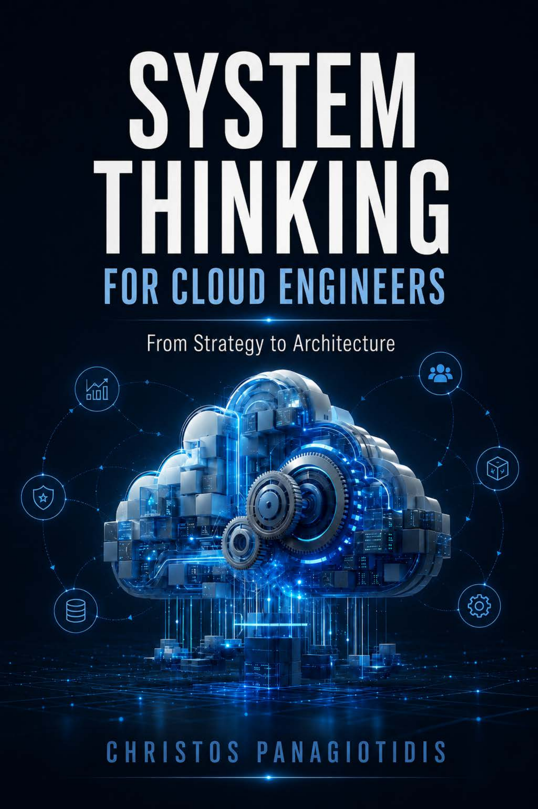
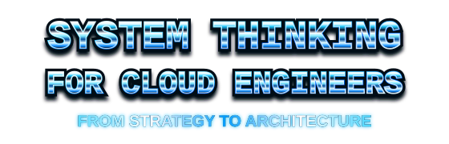
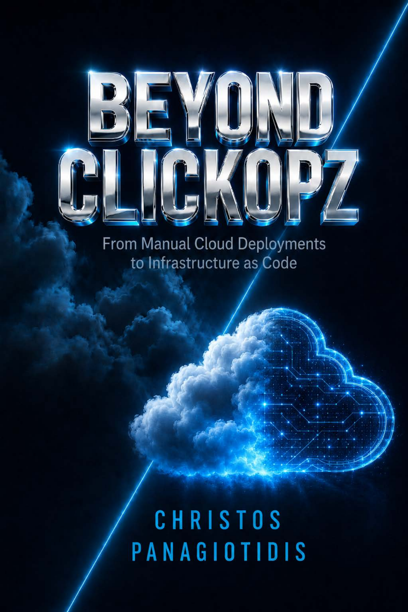
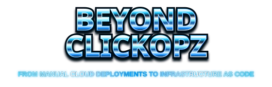

<!-- Animated Header Banner with Twinkling Effect -->
<p align="center">
  
</p>

<!-- Typing SVG -->
<p align="center">
  <a href="https://git.io/typing-svg">
    
  </a>
</p>

<!-- Social Badges -->
<p align="center">
  <a href="http://www.beyondcloudwithchriz.com/">
    
  </a>
  <a href="https://www.linkedin.com/in/christospanagiotidis/">
    
  </a>
  <a href="https://twitter.com/jamonyvice">
    
  </a>
</p>

<!-- Divider -->


##  About Me

<!-- Microsoft Community Credentials -->
<p align="center">
  <a href="https://mvp.microsoft.com/">
    
  </a>
  &nbsp;
  <a href="https://learn.microsoft.com/en-us/credentials/certifications/mct-certification">
    
  </a>
</p>


```yaml
name: Chris Panagiotidis
location: Germany 🇩🇪
current_role: Azure Cloud Engineer
community_roles:
  - Microsoft MVP
  - Microsoft Certified Trainer (MCT)

focus_areas:
  - Azure Infrastructure & Networking
  - Terraform & Infrastructure as Code
  - Cloud Coaching & Mentoring
  - Hands-On Lab Development

currently_building:
  - AKS Landing Zone Lab (Enterprise AKS platform)
  - Azure Network Lab (AZ-700 Prep)
  - Azure From Zero To Hero Lab

fun_fact: "I believe the best way to learn is by doing!"
```

<br clear="right"/>

<!-- Divider -->


## 📚 Featured Projects

<!-- Project Showcase Cards -->
<h3 align="center">☁️ Foundations &amp; Landing Zones</h3>

<table align="center" width="100%">
<tr>
<td align="center" valign="top" width="25%">
<a href="https://github.com/Jamonygr/aks-landing-zone-lab">

<br><b>AKS Landing Zone Lab</b>
<br><sub>Enterprise AKS platform with landing zones, runbooks &amp; GitOps</sub>
<br><br>


</a>
</td>
<td align="center" valign="top" width="25%">
<a href="https://github.com/Jamonygr/azure-landing-zone-lab">

<br><b>Azure Landing Zone Lab</b>
<br><sub>Hub-spoke networking with firewall, VPN, identity, governance, and monitoring</sub>
<br><br>


</a>
</td>
<td align="center" valign="top" width="25%">
<a href="https://github.com/Jamonygr/azure-network-lab">

<br><b>Azure Network Lab</b>
<br><sub>Virtual WAN, Route Server, VPN, and private networking for AZ-700</sub>
<br><br>


</a>
</td>
<td align="center" valign="top" width="25%">
<a href="https://github.com/Jamonygr/Azure-From-Zero-To-Hero">

<br><b>Azure From Zero To Hero</b>
<br><sub>Learn Terraform and deploy Windows workloads, networking, security, and monitoring on Azure</sub>
<br><br>


</a>
</td>
</tr>
</table>

<h3 align="center">🎓 Azure Certification Labs</h3>

<table align="center" width="100%">
<tr>
<td align="center" valign="top" width="25%">
<a href="https://github.com/Jamonygr/az900-azure-fundamentals-labs">

<br><b>AZ-900 Fundamentals Labs</b>
<br><sub>Build Azure fundamentals through guided cloud, service, and governance exercises</sub>
<br><br>


</a>
</td>
<td align="center" valign="top" width="25%">
<a href="https://github.com/Jamonygr/az104-azure-administrator-labs">

<br><b>AZ-104 Administrator Labs</b>
<br><sub>28 guided labs and 1,250 practice questions covering Azure identity, storage, compute, networking, and monitoring</sub>
<br><br>


</a>
</td>
<td align="center" valign="top" width="25%">
<a href="https://github.com/Jamonygr/Azure-Solutions-Architect-Expert">

<br><b>AZ-305 Solutions Architect Labs</b>
<br><sub>Practise Azure architecture decisions across identity, data, continuity, infrastructure, and migration</sub>
<br><br>


</a>
</td>
<td align="center" valign="top" width="25%">
<a href="https://github.com/Jamonygr/az400-azure-devops-engineer-labs">

<br><b>AZ-400 DevOps Engineer Labs</b>
<br><sub>Practise source control, pipelines, security, and observability with Azure DevOps and GitHub</sub>
<br><br>


</a>
</td>
</tr>
</table>

<h3 align="center">🌐 Networking &amp; Hybrid Infrastructure</h3>

<table align="center" width="100%">
<tr>
<td align="center" valign="top" width="25%">
<a href="https://github.com/Jamonygr/azure-virtual-network-manager-lab">

<br><b>Azure Network Manager Lab</b>
<br><sub>Validate connectivity, security rules, IPAM, and routing from hub-spoke to mesh</sub>
<br><br>


</a>
</td>
<td align="center" valign="top" width="25%">
<a href="https://github.com/Jamonygr/azure-virtual-network-manager-ipam-lab">

<br><b>Azure Network Manager IPAM Lab</b>
<br><sub>Allocate IPAM prefixes and explore policy-driven networking, firewall inspection, and mesh connectivity</sub>
<br><br>


</a>
</td>
<td align="center" valign="top" width="25%">
<a href="https://github.com/Jamonygr/azure-arc-hybrid-management-lab">

<br><b>Azure Arc Hybrid Management Lab</b>
<br><sub>Manage hybrid Windows and Linux servers with policy, monitoring, and patching</sub>
<br><br>


</a>
</td>
<td align="center" valign="top" width="25%">
<a href="https://github.com/Jamonygr/full-ad-domain-lab">

<br><b>Full AD Domain Lab</b>
<br><sub>Build Azure-hosted Active Directory with DNS, group policies, PKI, and services</sub>
<br><br>


</a>
</td>
</tr>
</table>

<h3 align="center">🛠️ Platforms &amp; Workloads</h3>

<table align="center" width="100%">
<tr>
<td align="center" valign="top" width="25%">
<a href="https://github.com/Jamonygr/azure-avd-lab">

<br><b>Azure Virtual Desktop Lab</b>
<br><sub>Deploy pooled desktops, RemoteApps, FSLogix profiles, autoscale, and operational monitoring</sub>
<br><br>


</a>
</td>
<td align="center" valign="top" width="25%">
<a href="https://github.com/Jamonygr/azure-platform-engineering-lab">

<br><b>Azure Platform Engineering Lab</b>
<br><sub>Build self-service golden paths with automated provisioning, deployment, monitoring, and cleanup</sub>
<br><br>


</a>
</td>
<td align="center" valign="top" width="25%">
<a href="https://github.com/Jamonygr/azure-private-build-agents-lab">

<br><b>Azure Private Build Agents Lab</b>
<br><sub>Provision private Managed DevOps Pools with controlled egress and private endpoints</sub>
<br><br>


</a>
</td>
<td align="center" valign="top" width="25%">
<a href="https://github.com/Jamonygr/windows-failover-clustering-lab">

<br><b>Windows Failover Clustering Lab</b>
<br><sub>Deploy two-node Windows clusters with shared disks, Cloud Witness, and failover drills</sub>
<br><br>


</a>
</td>
</tr>
</table>

<h3 align="center">📊 Operations, Security &amp; Resilience</h3>

<table align="center" width="100%">
<tr>
<td align="center" valign="top" width="25%">
<a href="https://github.com/Jamonygr/azure-operation-lab">

<br><b>Azure Operation Lab</b>
<br><sub>Practise Azure monitoring, patching, automation, backup, governance, and incident response</sub>
<br><br>


</a>
</td>
<td align="center" valign="top" width="25%">
<a href="https://github.com/Jamonygr/Azure-Security-Lab">

<br><b>Azure Security Lab</b>
<br><sub>Explore firewall segmentation, secrets, policy, and security monitoring across hub-spoke networks</sub>
<br><br>


</a>
</td>
<td align="center" valign="top" width="25%">
<a href="https://github.com/Jamonygr/finops-lab">

<br><b>Azure FinOps Lab</b>
<br><sub>Control Azure spend with budgets, cost exports, Infracost, and shutdown schedules</sub>
<br><br>


</a>
</td>
<td align="center" valign="top" width="25%">
<a href="https://github.com/Jamonygr/azure-chaos-studio-lab">

<br><b>Azure Chaos Studio Lab</b>
<br><sub>Practise controlled CPU pressure and shutdown experiments against Windows scale sets</sub>
<br><br>


</a>
</td>
</tr>
</table>

<table align="center" width="100%">
<tr>
<td align="center" valign="top" width="50%">
<a href="https://github.com/Jamonygr/azure-migration-lab">

<br><b>Azure Migration Lab</b>
<br><sub>Practise Azure-hosted application, SQL, and file migration with rehearsal, cutover, rollback, and cleanup</sub>
<br><br>


</a>
</td>
<td align="center" valign="top" width="50%">
<a href="https://github.com/Jamonygr/sre-agent">

<br><b>SRE Agent Azure Lab</b>
<br><sub>Practise Azure incident detection, telemetry, and guided remediation with Monitor and Automation</sub>
<br><br>


</a>
</td>
</tr>
</table>

<h3 align="center">⚙️ Terraform &amp; AI</h3>

<table align="center" width="100%">
<tr>
<td align="center" valign="top" width="33%">
<a href="https://github.com/Jamonygr/certified-terraform-associate-azure-edition">

<br><b>Terraform Associate: Azure Edition</b>
<br><sub>Prepare for Terraform Associate with Azure scenarios covering workflows, state, and modules</sub>
<br><br>


</a>
</td>
<td align="center" valign="top" width="33%">
<a href="https://github.com/Jamonygr/azure-terraform-pipeline-with-stages">

<br><b>Azure Terraform Pipeline</b>
<br><sub>Separate Terraform plan and apply stages using Azure DevOps YAML pipelines</sub>
<br><br>


</a>
</td>
<td align="center" valign="top" width="33%">
<a href="https://github.com/Jamonygr/ai-lab">

<br><b>Azure AI Lab</b>
<br><sub>Learn Azure AI fundamentals, retrieval, responsible AI, and evaluation with practical exercises</sub>
<br><br>


</a>
</td>
</tr>
</table>

<table align="center" width="100%">
<tr>
<td align="center" valign="top" width="50%">
<a href="https://github.com/Jamonygr/Terraforming-Azure">

<br><b>Terraforming Azure</b>
<br><sub>Learn Terraform and Azure through 40 labs, 200 explained questions, and a staged hub-spoke capstone</sub>
<br><br>


</a>
</td>
<td align="center" valign="top" width="50%">
<a href="https://github.com/Jamonygr/terraform-github-actions">

<br><b>Terraform GitHub Actions</b>
<br><sub>Reuse Terraform workflows with Azure OIDC, plan/apply, security checks, cost review, and drift detection</sub>
<br><br>


</a>
</td>
</tr>
</table>

<h3 align="center"><big>📖 Free eBooks</big></h3>

<table align="center">
<tr>
<td align="center" width="35%">
<a href="./System%20Thinking%20for%20Cloud%20Engineers.pdf">

</a>
</td>
<td align="center" width="65%">
<a href="./System%20Thinking%20for%20Cloud%20Engineers.pdf">

</a>
<br><br>
<sub>A practical 366-page guide to designing Azure as a connected, adaptive platform through systems thinking, the Cloud Adoption Framework, landing zones, Terraform, validation, governance, security, operations, and continuous improvement.</sub>
<br><br>
<a href="./System%20Thinking%20for%20Cloud%20Engineers.pdf">

</a>
</td>
</tr>
<tr>
<td align="center" width="35%">
<a href="https://github.com/Jamonygr/Azure-From-Zero-To-Hero/blob/main/ClickopzBook.pdf">

</a>
</td>
<td align="center" width="65%">
<a href="https://github.com/Jamonygr/Azure-From-Zero-To-Hero/blob/main/ClickopzBook.pdf">

</a>
<br><br>
<a href="https://github.com/Jamonygr/Azure-From-Zero-To-Hero/blob/main/ClickopzBook.pdf">

</a>
</td>
</tr>
</table>


<!-- Divider -->


## ⚡ Tech Stack & Skills

<p align="center">
  
  
  
  
  
  
  
  
  
  
</p>

<!-- Cloud & Infrastructure -->
<details open>
<summary><b>☁️ Cloud & Infrastructure</b></summary>
<br>
<p align="center">
  
  
  
</p>
</details>

<!-- Automation & IaC -->
<details open>
<summary><b>🔧 Automation & IaC</b></summary>
<br>
<p align="center">
  
  
  
  
</p>
</details>

<!-- Monitoring & Tools -->
<details open>
<summary><b>📊 Monitoring & Tools</b></summary>
<br>
<p align="center">
  
  
  
  
  
</p>
</details>

<!-- DevOps & Collaboration -->
<details open>
<summary><b>🛠️ DevOps & Collaboration</b></summary>
<br>
<p align="center">
  
  
  
  
  
  
</p>
</details>

<!-- Divider -->


## 🎯 Focus Areas

<p align="center">
  
  
  
  
</p>

<!-- Divider -->


##  GitHub Analytics

<!-- GitHub Stats using Profile Summary Cards (working alternative) -->
<p align="center">
  
</p>

<p align="center">
  
  
  
</p>

<!-- Activity Graph -->
<p align="center">
  
</p>

<!-- GitHub Stats Badges -->
<p align="center">
  
  
</p>

<!-- Divider -->


## 📫 Let's Connect!

<p align="center">
  <a href="http://www.beyondcloudwithchriz.com/">
    
  </a>
</p>

<p align="center">
  <a href="http://www.beyondcloudwithchriz.com/">
    
  </a>
  &nbsp;&nbsp;&nbsp;&nbsp;
  <a href="https://www.linkedin.com/in/christospanagiotidis/">
    
  </a>
  &nbsp;&nbsp;&nbsp;&nbsp;
  <a href="https://twitter.com/jamonyvice">
    
  </a>
  &nbsp;&nbsp;&nbsp;&nbsp;
  <a href="https://github.com/Jamonygr">
    
  </a>
</p>

<!-- Divider -->


## ✨ Quote I Live By

<p align="center">
  
</p>

<p align="center">
  
</p>

<!-- Snake Animation -->
<p align="center">
  <picture>
    <source media="(prefers-color-scheme: dark)" srcset="https://raw.githubusercontent.com/platane/platane/output/github-contribution-grid-snake-dark.svg">
    <source media="(prefers-color-scheme: light)" srcset="https://raw.githubusercontent.com/platane/platane/output/github-contribution-grid-snake.svg">
    
  </picture>
</p>

<!-- Animated Footer -->
<p align="center">
  
</p>

<p align="center">
  
  
  
</p>
